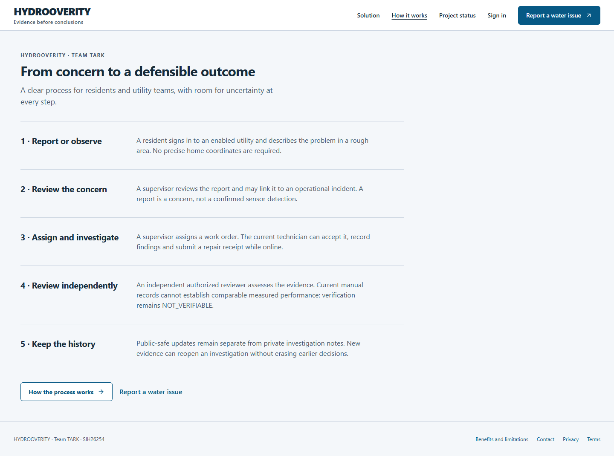
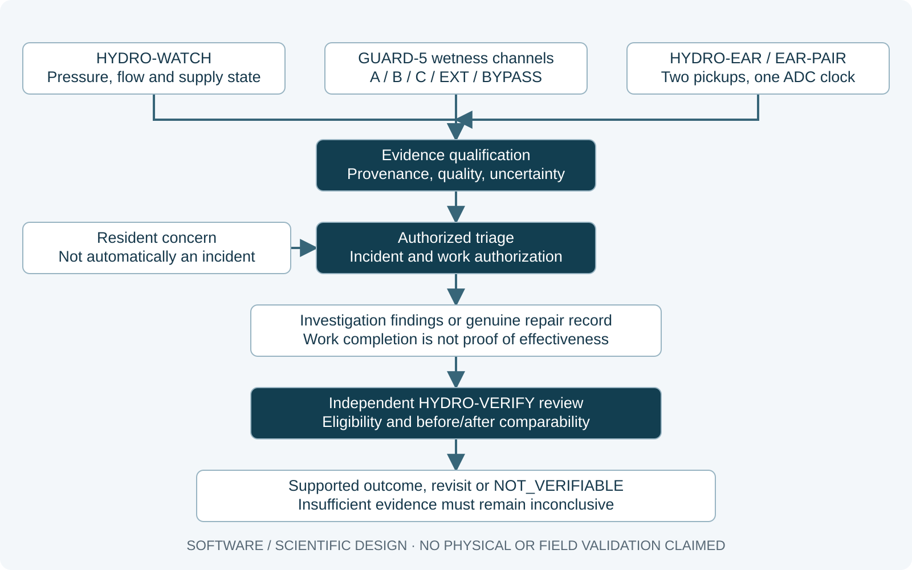
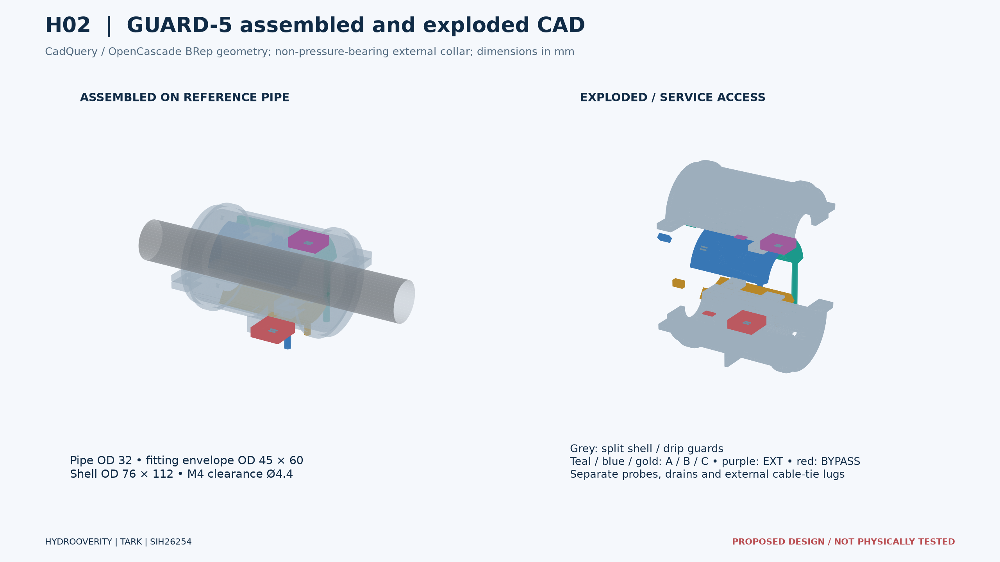
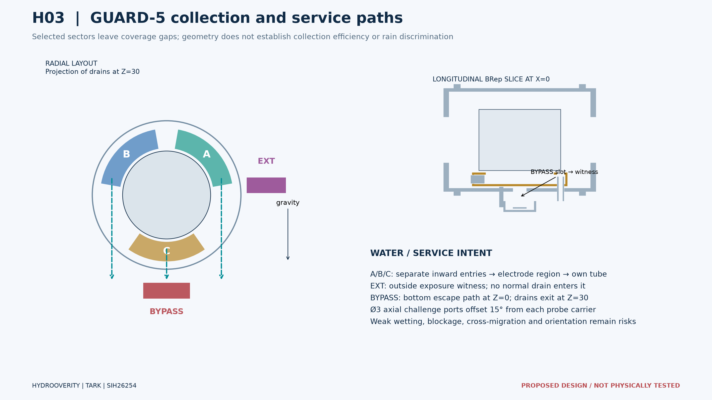
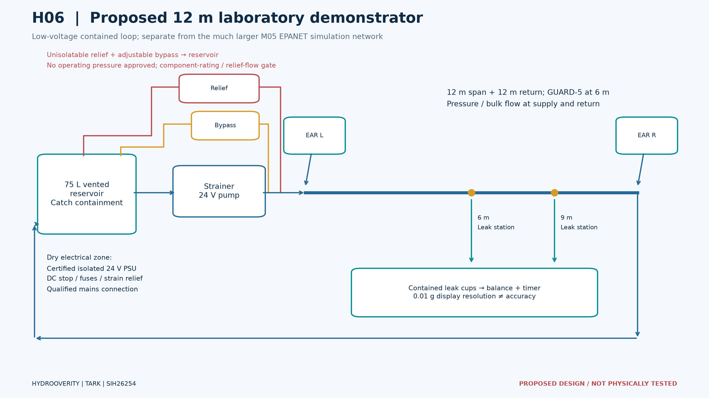
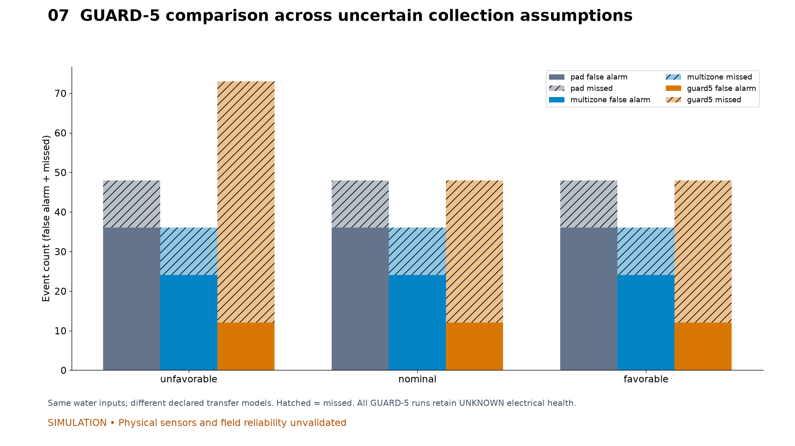

# HYDROOVERITY

### Find the leak. Understand the evidence. Verify the repair.

**Team TARK · Team ID 155480 · SIH26254 · Smart India Hackathon 2026**
Hardware · Clean & Green Technology · Ministry of Jal Shakti

[](https://github.com/siddalakarthik/HYDROOVERITY-SIH26254/actions/workflows/repository-integrity.yml)

[Website setup](apps/web/README.md) · [Engineering evidence](docs/README.md) · [Current completion register](docs/testing/PRE_M10_COMPLETION_REGISTER.md) · [Digital hardware](hardware/README.md)

HYDROOVERITY connects resident reports, utility investigation and independent repair review with qualified hydraulic, wetness and acoustic evidence. It addresses **Development of Indigenous Leak Detection Sensor Systems for Operation & Maintenance of Water Supply Pipelines**.

**Working software. Simulation-only scientific evidence. Proposed digital hardware.** The repository is public; the application remains restricted to private development. No deployed village installation, physically tested device or field performance is claimed.



*Actual application capture from M09 browser acceptance; synthetic development environment. [Frontend source](apps/web/src/features/public.tsx) · [Browser evidence](docs/testing/M09_FULL_SYSTEM_ACCEPTANCE.md).*

## What works today

| Area | Implemented scope | Boundary |
| --- | --- | --- |
| Residents | Authenticated complaints and service requests, secure ownership-based tracking, timelines, follow-ups, appointment requests and feedback | A request is not an incident, booking or confirmed leak |
| Utility operations | Supervisor triage, authorized incident/work linkage, investigation findings, technician assignment and dispatch, versioned changes | Scheduling is disabled until actual utility policy, shifts, skills and service areas are configured |
| Communications | Durable in-app queue, preferences, delivery/read history and guarded feedback review | External email/SMS/push and media remain gated; three total delivery attempts |
| Scientific workspace | Authorized synthetic ingestion, bounded stream/replay, observation-only exports and visible simulation mode | No live hardware adapter or ordinary-dashboard evaluator truth |
| Platform | FastAPI, PostgreSQL/PostGIS, tenant/role/owner enforcement, RLS, CSRF, idempotency and audit history | Production/public deployment remains disabled |

Current runtime: **112 registered API operations (111 existing + one gated contact protocol) · 53 migrated application tables · migration `pre_m10_002`**. Design catalogues contain additional proposed operations; they are not implemented endpoints. [Runtime contracts](services/api/hydro/contracts.py) · [Current acceptance inventory](docs/testing/M09_FULL_SYSTEM_ACCEPTANCE.md).

M01–M06 and the reviewed M08/M09 packages are merged. M07-A/B/C increments are merged, while the original M07 milestone remains open for residual scope. **M10 has not started.** Historical M09 recorded **21 PASS, 13 BLOCKED, 6 NOT IMPLEMENTED**. The current original-40 matrix is **22 PASS, 14 BLOCKED, 4 NOT IMPLEMENTED** after tested complaint notifications and blocked contact foundations ([current register](docs/testing/PRE_M10_COMPLETION_REGISTER.md)); passing CI does not mean every planned feature exists.

## Evidence before conclusions



[Editable architecture diagram](docs/architecture/evidence-flow.svg). Resident concerns and scientific evidence remain distinct inputs; neither automatically proves a leak.

- **HYDRO-WATCH** qualifies OFF, FILLING, STEADY, DRAINING or UNKNOWN context. Hydraulic imbalance is not automatically a leak; filling and unknown demand limit inference.
- **GUARD-5** investigates an accessible exposed joint with exactly five independent wetness channels: three protected collectors A/B/C, environmental witness EXT and separate lower BYPASS. Wetness does not establish its source.
- **HYDRO-EAR / EAR-PAIR** uses two matched contact pickups and one physical common-clock stereo ADC on an eligible surveyed span. Unknown wave speed, weak plastic-pipe signals, low pressure, branches and competing sources can prevent localization.
- **HYDRO-VERIFY** separates completed work from independently supported effectiveness. Manual records alone remain NOT_VERIFIABLE.

## Digital engineering, with physical limits visible



*Removable, non-pressure-bearing split collar. [Editable CadQuery source](hardware/mechanical-cad/guard5.py). Geometry checks are not physical fit tests.*



*Exactly A/B/C, EXT and BYPASS. Collection efficiency, blockage, crosstalk and environmental discrimination remain unverified.*



*Proposed rig, not an assembled device. [Rig source](hardware/mechanical-cad/rig_layout.json). Any future pressure points require safety review.*

[Common-clock acoustic diagram](docs/media/acoustic-clock.png) · [Estimated budget figure](docs/media/budget.png) · [Seven editable engineering figures and STEP reproduction](hardware/results/README.md)

The **₹60,000 materials ceiling** currently has a **₹59,870 estimate**, including reserve, and only **₹130 residual headroom**. All **41 prices are estimates**, not supplier quotations. That margin is a procurement risk. The proposed pressure sensor range is poorly suited to sensitive low-pressure measurements. KiCad files are connectivity drafts; native ERC, complete field firmware, a validated recorder and physical trials remain absent. [Itemized BOM](hardware/bom/M08_BOM.md) · [Engineering limitations](docs/engineering/M08_DIGITAL_HARDWARE_REPORT.md).

## Scientific results include the unfavorable cases



*SIMULATED / PHYSICALLY UNVALIDATED. GUARD-5 nominal F1 was **0.714**, compared with **0.778** for a simple pad and **0.824** for a multizone baseline. Digital collector geometry does not overturn this result.*

The acoustic benchmark accepted **190/264** eligible captures; **74 remained unresolved**, and **20 accepted intervals excluded truth**. Small ideal-model errors do not establish hardware precision. WATCH missed a small modeled leak and produced drift-related suspicion. EPANET is not a complete filling/transient or water-hammer model.

[Full M05 denominators, controls and limitations](docs/testing/M05_SIMULATION_EVIDENCE_REPORT.md) · [Reproduction](simulations/README.md) · [M06 integration boundary](docs/testing/M06_SCIENTIFIC_INTEGRATION.md)

## Run locally and verify

Use the pinned versions and isolated environments in the subsystem guides. No paid API or public deployment is required.

```sh
# Repository root: foundation and design checks
python scripts/check_repository.py
python scripts/check_m02_design.py
python scripts/check_pre_m10.py
git diff --check

# Node 24 and the repository-pinned pnpm version
cd apps/web
pnpm install --frozen-lockfile --ignore-scripts
pnpm run build
pnpm run start
```

The public-page preview listens on `http://127.0.0.1:3000`. Authentication needs the real backend and verified localhost HTTPS described in the [web guide](apps/web/README.md) and [API guide](services/api/README.md); do not weaken Secure cookies or TLS verification. A localhost URL works only on the machine running those services.

Four CI jobs cover repository/design/scientific checks, PostgreSQL/backend acceptance, real frontend browser workflows, and regenerated CAD/figures. CI artifacts have a **14-day retention period**; durable source and evidence reports remain in Git. [CI runs](https://github.com/siddalakarthik/HYDROOVERITY-SIH26254/actions) · [M09 report](docs/testing/M09_FULL_SYSTEM_ACCEPTANCE.md).

The [current frontend dependency review](docs/testing/CURRENT_DEPENDENCY_REVIEW.md) records zero active registry advisories on 26 October 2026 for the unchanged lockfile. The earlier development-only `braces` advisory was withdrawn upstream; historical audit evidence is preserved. Project licensing and native-binary redistribution obligations remain unresolved.

## Find the source

| Path | Contents |
| --- | --- |
| [apps/web](apps/web/README.md) | Next.js / React / TypeScript application, generated contracts and browser tests |
| [services/api](services/api/README.md) | FastAPI domain logic, PostgreSQL migrations, authorization and acceptance tools |
| [simulations](simulations/README.md) | Hydraulic, acoustic and GUARD-5 engines and reproducible evaluation |
| [hardware](hardware/README.md) | Parametric CAD, connectivity drafts, interfaces, calibration plans and estimated BOM |
| [docs](docs/README.md) | Contracts, decisions, engineering reports and current completion register |
| [docs/media](docs/media/README.md) | Small reviewed presentation previews, source hashes and reproduction |
| [tests](tests/README.md) | Scientific, design and hardware checks; application tests also live beside their source |
| [.github](.github/DEVELOPMENT_SETUP.md) | Required CI, issue templates and original backlog |

Visit-access data, images, offline mutations, external delivery, legal retention and public deployment retain their respective D6–D10/release gates. Native zoom, full assistive-technology coverage and long-duration field reliability are not certified. Accepted development dependency/license limitations remain recorded in the [M04 execution ledger](docs/testing/M04_EXECUTION_LEDGER.md).

Read [AGENTS.md](AGENTS.md), [CONTRIBUTING.md](CONTRIBUTING.md) and [SECURITY.md](SECURITY.md). The project license is undecided: a public repository does not grant an open-source license. Preserve third-party attribution and never commit credentials, resident data, evaluator ground truth or raw private experiments.
