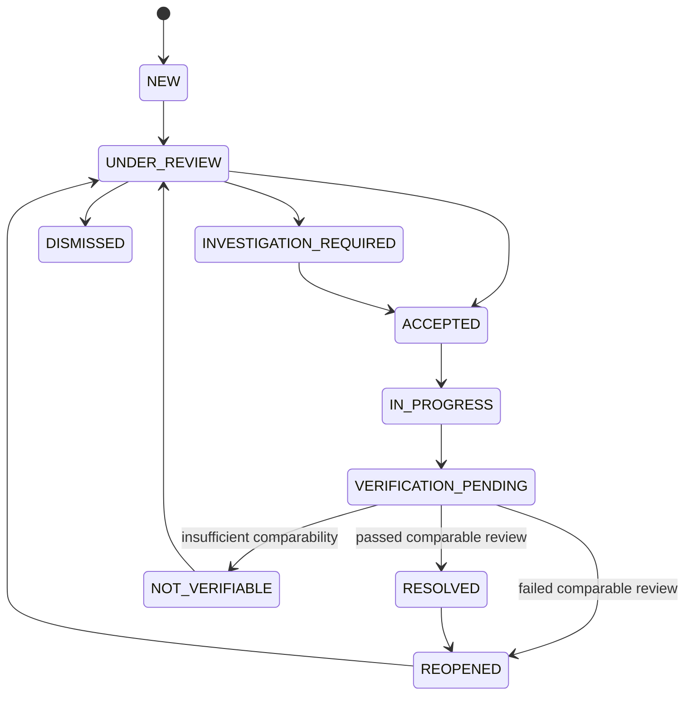

# Domain state machines

Issue #2; canonical names match OpenAPI and database enum catalogue. Status domains are independent. Every human transition requires current permission, correct tenant/parent, expected version, UTC receipt timestamp, actor/reason, immutable history and atomic outbox/audit. System transitions identify versioned algorithm/config and source window. Unknown/stale inputs never become confident no-leak results.

## Supply

OFF -> FILLING when pressure/flow recovery observations support filling; FILLING -> STEADY only when actual reviewed stability conditions hold; STEADY -> DRAINING on supported pressure/flow decline; DRAINING -> OFF on qualified no-service evidence. Recovery/reversal may return FILLING/STEADY when evidence warrants. Any state -> UNKNOWN on missing/stale/conflicting critical context, UNKNOWN -> any state only after sufficient valid observation window. Exact pressure/stability/freshness thresholds are future versioned scientific configuration, not fixed elapsed minutes. Direct wetness/fault/severe confirmed pressure-collapse events bypass routine attribution gates during filling/draining; they do not force a leak diagnosis.

## Device health

HEALTHY, DEGRADED, DISCONNECTED, STALE, CALIBRATION_NEEDED, FAULT, UNKNOWN are presentation summaries over independent fault flags (transport, signal, calibration, electrical). Missing receipts ->STALE; confirmed link disconnection ->DISCONNECTED; explicit supervised electrical failure ->FAULT; expired required calibration ->CALIBRATION_NEEDED; usable compromised channels ->DEGRADED; adequate valid context ->HEALTHY. Unsupported electrode supervision ->UNKNOWN health for dry/disconnect discrimination, never invented electrical proof. Priority summary FAULT > DISCONNECTED > STALE > CALIBRATION_NEEDED > DEGRADED > HEALTHY, UNKNOWN when prerequisite evidence absent; retain all flags and reasons. Recovery appends actual service/receipt evidence, not timer-only clearance.

## Evidence

Immutable assessments use disposition OBSERVED, SUSPECTED, QUALIFIED_CANDIDATE, UNRESOLVED or FAULT and a separate kind. Raw wetness observations may be documented CONFIRMED_LOCAL_WETNESS as a measurement fact in explanation/record type, not a physical-leak-confirmed enum. ENVIRONMENTAL_WETNESS/COLLECTION_FAILURE/SENSOR_FAILURE compete with LOCAL_JOINT_SUSPICION. ACOUSTIC_CANDIDATE +QUALIFIED_CANDIDATE requires eligible capture/uncertainty/quality; insufficient pressure/signal/path ambiguity produces UNRESOLVED or FAULT with explicit reason and no location. New evidence supersedes assessment; no in-place certainty upgrade. Calibration probability remains absent unless independently calibrated.

## Incident lifecycle

NEW -> UNDER_REVIEW -> INVESTIGATION_REQUIRED or ACCEPTED or DISMISSED. INVESTIGATION_REQUIRED -> ACCEPTED or DISMISSED with reviewed evidence/reason. ACCEPTED -> IN_PROGRESS once work is assigned/accepted; IN_PROGRESS -> VERIFICATION_PENDING after repair receipt and submitted work. VERIFICATION_PENDING -> RESOLVED only on authorized passed verification; -> REOPENED on failed verification; -> NOT_VERIFIABLE when comparability/observability inadequate. REOPENED -> UNDER_REVIEW/IN_PROGRESS with new event and preserved history. NOT_VERIFIABLE -> UNDER_REVIEW on new evidence; RESOLVED -> REOPENED on justified recurrence. DISMISSED -> UNDER_REVIEW with new information. Supervisor executes lifecycle transitions; engineer may create assessments/incidents but not bypass triage. No pressure does not dismiss an incident.

WORK_ORDERED and REPAIR_PENDING are derived work-order substatus labels, not duplicate incident enums. Public complaint resolution may reflect service outcome without asserting scientific incident RESOLVED. M01's UNVERIFIABLE vocabulary maps to canonical NOT_VERIFIABLE; REPAIR_CHECK maps to VERIFICATION_PENDING. Historical source text is preserved, not silently rewritten.

## Work order

CREATED -> ASSIGNED by supervisor; ASSIGNED -> ACCEPTED by current technician; ACCEPTED -> IN_PROGRESS; IN_PROGRESS -> BLOCKED (reason) or SUBMITTED_FOR_REVIEW; BLOCKED -> IN_PROGRESS after recorded unblocking; SUBMITTED_FOR_REVIEW -> COMPLETED by supervisor or IN_PROGRESS with requested changes. Supervisor may reassign active work (increment assignment_version and notify), or CANCELLED with reason before completion; completed/cancelled history is immutable, further work creates new linked task. Technician cannot complete/cancel/reassign. Repair receipt required for repair-type submission; investigation-only task may submit documented findings without claiming repair. Completion is operational acceptance, not verification.

## Verification and simulations

Verification is append-only outcome VERIFICATION_PASSED, VERIFICATION_FAILED or NOT_VERIFIABLE. PASSED/FAILED require comparable before/after evidence; missing calibration/pressure/context ->NOT_VERIFIABLE with reason. Supervisor reviews, seeking engineer interpretation where uncertainty remains; no forced acceptance of an acoustic location. Worker cannot approve own outcome. A new review supersedes prior record, preserving all outcomes.

Run statuses: QUEUED -> RUNNING; QUEUED -> CANCELLED; RUNNING -> SUCCEEDED/FAILED/TIMED_OUT/CANCEL_REQUESTED; CANCEL_REQUESTED -> CANCELLED or SUCCEEDED if completed transaction already won. No final success metrics from partial outputs. Background job lease retry does not create a new scientific seed/config. Completed sealed run only is eligible for separately authorized evaluation.

Complaint status RECEIVED/UNDER_REVIEW/INVESTIGATING/ACTION_PLANNED/UPDATE_AVAILABLE/RESOLVED/CLOSED_NO_ACTION is a public-safe projection authored by supervisor; no internal private notes leak through mapping. Feedback NEW/TRIAGED/PLANNED/RESOLVED/DECLINED requires resolution reason. No automatic sensor-to-confirmed-leak transition exists in any domain.
