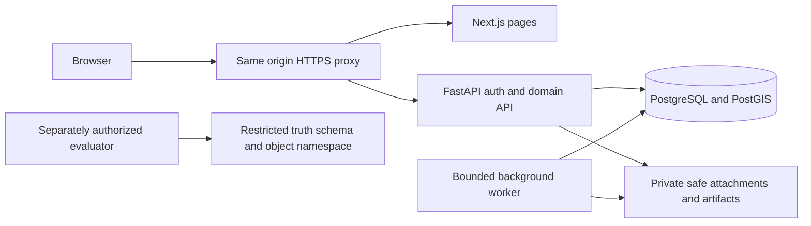

# Deployment and stack decisions

M02 issue #2; proposal awaiting review, no packages, database, credentials, services or deployment created. Version families below are a compatible design recommendation, not installed/tested lockfiles or a claim to be globally latest. M03/M04 must select maintained exact patches, lock dependencies and run integration/security checks before use.

| Layer | Recommendation | Evidence / limitation |
| --- | --- | --- |
| Frontend runtime | Node24 LTS | Official release table lists24 LTS; Next requires>=20.9, so24 satisfies floor; choose patched24 release at installation |
| Web | Next16 App Router, React19.2 family, TypeScript5.x | Official Next16 material describes React19.2 features; match react/react-dom peer versions, avoid canary-only dependencies |
| Styling/visualization | Tailwind4, Recharts3 candidate, MapLibre GL JS5 candidate | Keep original specified technologies; exact peer/browser compatibility is a M04 lockfile gate, not verified by this document |
| Backend | Python3.12, FastAPI stable0.x with Pydantic2, SQLAlchemy2, Alembic1, psycopg3 | FastAPI advises pinning known-compatible versions; exact tested patch set chosen in M03, do not copy docs example version as latest |
| Database | PostgreSQL17 + PostGIS3.5 maintained patches | Official PostGIS3.5 docs cover PostgreSQL12–18;17 is conservative supported family; choose maintained combined image/digest in M03 |
| Tests | pytest8+, Vitest3+ candidate, Playwright1.x candidate | Tool versions must match runtime at installation; no tests installed/run for nonexistent app |
| Science | Separate Python worker environment; NumPy/SciPy/Pandas/WNTR/EPANET2.2 | Keep scientific stack; solver/package compatibility and numerical behavior reviewed in M05 rather than pretending frontend review validates it |

## Simple topology

Browser -> HTTPS same-origin proxy -> Next.js web for pages / FastAPI for `/api/v1` including SSE. FastAPI owns auth/domain logic and connects to one private PostgreSQL/PostGIS database plus private attachment volume/object adapter. One optional worker process claims background_jobs for bounded exports/analysis/science later. Ingestion/notifications are modules/logical boundaries, not three mandatory network microservices. No Redis/Kafka/search cluster now. The restricted generator/evaluator connection and truth object namespace are separate from detector/ordinary API credentials, even on a single machine; worker execution must not inherit both credentials in one detector process.

Local development will use Docker Compose with private DB/object volumes and a local HTTPS proxy; only proxy exposed by default. No compose file is created in M02 because it would imply runnable services before implementation. Environment names in .env.example remain placeholders. Later configuration includes database/session verifier settings, allowed origin, upload directory, worker role, approved tile URL, retention policy and mode. Never put secrets in NEXT_PUBLIC variables; no cloud production credentials now.

Hosted pilot may use a modest single host with persistent disks and encrypted off-host backups or managed Postgres if owner approves budget/operations. Do not buy hosting now or invent an INR quotation. Hosting, backup, email, object transfer and tile costs are recurring operating costs separate from ₹60,000 hardware-material ceiling. Availability/throughput remains unmeasured. Avoid free-tier sleep assumptions for live monitoring.

Define liveness (process alive) separate from readiness (required DB/migrations accessible) during M03; readiness returns no secrets and never reports success with unavailable persistence. Proxy SSE buffering disabled; body/time/concurrency limits explicit. Worker lease/attempt limits prevent uncontrolled simulations; requested parameters never become arbitrary shell code. Back up DB plus private object manifest, encrypt/access-control, retain proposed7daily/4weekly snapshots subject to approved policy, test restore before pilot and after schema changes. Structured request IDs and safe error categories, no raw personal payload/token logging; basic resource/queue/failure monitoring before adding observability services.

Primary references checked20October2026: [Node releases](https://nodejs.org/en/about/previous-releases), [Next installation](https://nextjs.org/docs/app/getting-started/installation), [Next16](https://nextjs.org/blog/next-16), [FastAPI version policy](https://fastapi.tiangolo.com/deployment/versions/), [PostGIS3.5 requirements](https://postgis.net/docs/manual-3.5/postgis_installation.html). These support stated floors/families, not an executed compatibility test. Patch/security review remains mandatory at installation.
