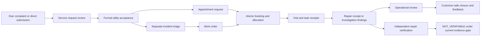

# HYDROOVERITY — M07 service management engineering design and acceptance plan

Team TARK · SIH26254 · Prepared 22 October 2026 (Asia/Kolkata)

**Status: PROPOSED / OWNER REVIEW REQUIRED. Planning only.** This document is outside the Git checkout. It introduces no live contract, migration, application change, branch, deployment, external message or merge. API proposals are specified in the companion [API and schema proposal](M07_API_AND_SCHEMA_PROPOSAL.md). Approval of this design is separate from authorization to implement it.

**Owner review update:** [Conditional architecture approval and adopted decisions](M07_OWNER_REVIEW_DECISION.md) supersede the alternatives below. M07-A/B/C is the approved priority order; PDF, external delivery and offline features are deferred. No proposed retention number is approved legal policy. Contract work waits for owner-approved M04 merge and green main CI.

## 1. Recommendation and scope

Extend the existing FastAPI/PostgreSQL/PostGIS application and M04 Next.js frontend with a service-request aggregate, a transactional appointment scheduler, safe resident communications and a quarantined attachment service. Retain the existing identity, complaint, incident, work-order, repair and verification domains. Use PostgreSQL for booking constraints, outbox and bounded background jobs; do not add another identity provider, commercial calendar, paid API or separate queue database.

The first operational release should support three current water-service categories: visible leak, low pressure and service interruption. A resident submission is a request for review, not an accepted service commitment or confirmed leak. Appointment availability is derived only from a supervisor-published calendar with eligible staff and explicit time estimates. No roster, working hours, holidays, travel times, service SLA or availability is invented.

The mandatory baseline is online-authorized service management with useful connection-error states. Optional encrypted offline notes remain a separately gated increment within M07, not an assumed M04 feature. Booking, cancellation, assignment, final submission, closure and verification always require online authorization.

### Verified baseline

Read-only GitHub metadata and local source inspection established:

| Item | Inspected state |
| --- | --- |
| Main | `e0122f5ee4146e49ae6113a1aa6a5ee444b25973` |
| M04 | [PR #16](https://github.com/siddalakarthik/HYDROOVERITY-SIH26254/pull/16), OPEN, unmerged |
| M04 head | `196a5902e8be77a8017c1a97e9abad671345b2c9`, branch `feature/m04-frontend-foundation` |
| Backend | 58 reachable operations; 30 implemented application tables; Alembic through `m03_004` |
| M02 catalogue | 117 proposed operations, 57 tables; catalogue presence is not implementation |
| M04 routes | 46 classified: 20 functional, four read only, nine informational, thirteen deferred |
| Local checkout | Clean before planning; application/source files are not changed by this task |

Historical M01/M02 documents sometimes say “not implemented”; current M03 code and M04 delivery records take precedence for actual software availability. M01/M02/M03/M05/M08 merge status does not imply M06 scientific integration or production readiness.

### Authority inspected

Source paths below refer to the inspected M04 checkout at the head above, not a new M07 implementation:

- `AGENTS.md`; `docs/project/HYDROOVERITY_MASTER_CONTEXT.md`; `docs/project/ROADMAP.md`.
- `docs/architecture/{DATABASE_DESIGN,API_CONTRACTS,DOMAIN_STATE_MACHINES,ROLE_PERMISSION_MATRIX,AUTH_SECURITY_AND_PRIVACY,REALTIME_OFFLINE_AND_NOTIFICATIONS,DATA_CONTRACTS_AND_PROVENANCE,PRODUCT_INFORMATION_ARCHITECTURE,SYSTEM_ARCHITECTURE,THREAT_MODEL}.md` and the canonical `openapi-design.json`.
- `services/api/hydro/{contracts,tenant,dispatch,events,main,config}.py`; implemented complaints, work-order, repair and verification services; schema/security SQL and migration `m03_004`.
- `apps/web/src/features/{complaints,work,workspace,administration,auth}.tsx`, shared UI and API transport, local proxy; M04 route/API matrix, implementation report and execution ledger.
- `design/design-system/UI_UX_DESIGN_SYSTEM.md`; M08 and master-context scientific/hardware limitations inherited by the public website.

### Frozen scientific and security boundaries

HYDRO-WATCH remains pressure/flow and demand/storage/supply-state context with OFF/FILLING/STEADY/DRAINING/UNKNOWN. GUARD-5 remains exactly A/B/C, EXT and BYPASS; no extra wetness channel or claim of verified collector performance. HYDRO-EAR retains two pickups, one physical common-clock stereo ADC, eligible surveyed spans, uncertainty and abstention. Scheduling does not use simulated supply windows as promised service availability.

Customer reports, attendance, photographs, repair receipts, satisfaction scores and completed work do not establish scientific leak detection, measured water savings or a verified repair. M03 currently permits independent **NOT_VERIFIABLE only**. M07 preserves that restriction; M06 or another separately approved evidence integration must establish comparable measured inputs before PASSED/FAILED can be enabled. No simulation truth, evaluation seeds or raw scientific capture is admitted through service attachments.

No public API release, device actuation, physical test, hardware purchase, scientific parameter change or video work is included. The INR60,000 hardware ceiling and M08 estimated INR59,870 total/INR130 procurement-risk margin remain unchanged.

## 2. Existing versus proposed capability matrix

“Designed” means approved M02 specification without an implemented route/table. “New” means a proposed M07 contract, not existing functionality.

| Capability | Current implementation | M02 designed but deferred | Proposed M07 delta |
| --- | --- | --- | --- |
| Resident intake | Own complaint create/list/detail/follow-up; three categories; coarse locality; authenticated tracking number | Consented images | Formal service submission linked to an owned complaint or submitted directly; explicit utility acceptance |
| Tracking | Authenticated own-complaint UUID/detail; random `HYD-` reference; no anonymous lookup | Tracking is explicitly not a bearer credential | Separate 128-bit random service reference; authenticated POST lookup; rate limits and uniform inaccessible response |
| Customer timeline | Public status updates and owner follow-ups; private review reason excluded; inline updates bounded to 100 | Event history/realtime | Cursor-paginated service timeline, public-safe system templates and explicitly authored updates |
| Service acceptance | Supervisor complaint review and optional internal incident link | No service-request aggregate | Service triage, declines, information requests, acceptance, operational closure/cancellation |
| Visit preferences | None | No appointment schema | Bounded preferred intervals, access instructions and accommodation requests; preferences never reserve capacity |
| Availability/appointments | None; `due_at` is a deadline, not a reserved visit | No scheduler | Published unit-capacity windows, requests, alternatives, atomic confirmation/rescheduling/cancellation |
| Dispatch/roster | Supervisor assigns an active technician by membership ID; no supervisor staff directory | Admin-only membership directory | Minimal dispatch roster, shifts, leave/breaks, skills, workload, conflict reporting and scheduling guards |
| Field execution | Current-assignment brief, acceptance/status edges, notes/materials, manual repair receipt | Offline vault/attachments/service tests | Assigned visit check-in/outcome receipts, attachment references and appointment linkage; no geolocation surveillance |
| Repair verification | Append-only independent NOT_VERIFIABLE; repair actor cannot self-review | Comparable measured PASSED/FAILED | Safe customer outcome summary; retain current scientific gate; review independence applies to everyone who performed work |
| Notifications | Audit/domain-event rows exist, but no delivery worker or notification API | Two in-app operations; queue, delivery attempts, optional email | Transactional service event fan-out, recipient preferences, bounded delivery/retry and safe audit |
| Feedback | No registered feedback routes/tables | Three feedback operations and two tables | Implement planned feedback; optional service link/rating after service closure; no scientific effect |
| Attachments | Incoming nonempty attachment IDs are explicitly rejected | Six operations, image-only quarantine/scan/derivative lifecycle | Implement image pipeline; add service parent; document/PDF stage requires explicit approval and a tested sanitization pipeline |
| Offline | No service worker, persistent private draft or write queue; brief expires in 15 minutes | Opt-in encrypted brief/vault with different proposed lease | Online baseline; separately approve lease reconciliation and offline notes/photos only |
| Operations reporting | Staff can inspect scoped work/incident pages; no report jobs | Export jobs and reports | Workload and service-response measures with honest denominators; limited operational export is optional, science analytics remain deferred |
| Maps | MapLibre over permitted PostGIS assets; citizen never loads topology | Further coverage/monitoring interfaces | Reuse staff map when relevant; service address stays separate from pipe topology; no paid routing/ETA |

### Material implementation gaps to resolve explicitly

1. **Work requires an incident.** Existing `work_orders.incident_id` is mandatory and `WorkOrderWrite` requires a triaged incident. For the initial M07 scope, accept a service request independently; before dispatch, a supervisor must link/create a genuine investigation incident under existing triage rules. Acceptance alone does not fabricate an incident or confirm a leak. Non-incident administrative visits and general utility billing/services remain deferred. Changing work orders to allow a service-only parent would be a separate substantive M02 contract change.
2. **Investigation-only submission is not supported as documented.** M02 permits findings without a repair, but current `SUBMITTED_FOR_REVIEW` unconditionally requires a repair receipt. Proposed correction: a reviewed task-purpose field and an investigation-findings receipt. Never enter a fake repair to satisfy the existing check. Details are in section 5 and the API proposal.
3. **Assignment is currently unconstrained by time.** It resets active work to ASSIGNED, updates due date and increments assignment version, without a schedule ledger. Every existing assignment/cancellation path must join M07 guards; a separate scheduler screen alone would leave a bypass.
4. **15-minute brief versus 12-hour offline design.** Current source returns 15 minutes and M04 explicitly disallows offline authorization. Do not silently adopt the historical 12-hour design. Offline implementation needs its own lease/security review.
5. **Photos versus documents.** M02 explicitly rejects PDF/SVG/HTML. Image upload is an unimplemented but approved design; PDF is a new, conditional proposal. Document support must not be advertised until its gate passes.
6. **16 KiB JSON transport.** The web transport and proxy have a 16 KiB limit; this is incompatible with 5 MiB files. Add a distinct, authenticated binary streaming route with its own exact limit and transport; retain the JSON limit everywhere else.
7. **Event rows are not notifications.** M03 writes safe audit/outbox rows, often an empty summary. Delivery requires durable consumer checkpoints, per-recipient authorization and safe template projections; do not send raw events.
8. **Availability data is absent.** A staff profile, explicit shifts, blocks, durations and buffers must exist before publishing windows. Unknown scheduling inputs produce no available windows, not assumed weekdays/free time.

## 3. Domain boundaries and service journeys

| Domain object | Meaning | Must never imply |
| --- | --- | --- |
| Citizen complaint | A resident's observed water/service concern | Utility acceptance, booked visit or confirmed physical cause |
| Service request | A submission which the utility can formally accept to manage investigation/service | Incident acceptance or guaranteed repair |
| Appointment request | Resident's selection/request or proposed replacement | Reserved capacity or confirmed attendance |
| Appointment | A confirmed visit commitment with a reserved technician interval | Work completion or scientific verification |
| Incident | Internal evidence-qualified concern under existing triage | A resident's whole service history or other reporters' identities |
| Work order | Authorized assigned task, purpose, instructions and operational lifecycle | A booked visit simply because `due_at` exists |
| Repair receipt | Immutable report of performed work and materials | Successful repair or comparable before/after evidence |
| Verification | Independent qualified review of an immutable repair receipt | Satisfaction score, technician assertion or automatic appointment completion |
| Feedback | Resident's service experience and follow-up concern | New scientific evidence proving success/failure |

A service can have several visits and work orders over its life. Many service cases can refer internally to one incident/work order, but each resident sees only their own case and explicitly safe summaries. Cross-customer links, internal IDs, staff contacts and notes never enter a resident DTO. Do not combine several residents into one appointment/capacity unit in the initial scheduler.

### Resident — mobile first

1. From the existing Report entry point, choose an enabled utility and sign in through M03. Report a concern using the existing complaint flow or explicitly request service review. An “Ask utility to arrange service” action on an existing own report prefills its safe data; it does not silently create duplicate complaints.
2. Review category, coarse location, description and consent. Exact visit/access text is optional initially, separately explained and disclosed only when needed for a visit. Do not request GPS, identity documents or a phone number merely to submit a case.
3. Show a persisted receipt/reference with “Submitted — awaiting utility review.” The owner can revisit it through My reports/service requests. Reference lookup requires login and ownership.
4. When accepted, show a service timeline distinct from verification. Enter up to five preferred date/time intervals; view only currently published windows for this case. Empty calendar says “No visit windows published; the utility must arrange a visit,” with a preference/information path that still works.
5. Select a window; confirmation screen says “Requested, not confirmed.” After utility confirmation, show the arrival interval, expected duration, timezone and cancellation terms. No moving map, fabricated technician ETA or private technician identity.
6. Request a replacement or cancellation. A requested replacement leaves the original booking visible as confirmed until an atomic replacement succeeds. Alternative acceptance can fail because the window filled; preserve the old booking and explain the next action.
7. Read safe visit/work updates, respond to information requests and view only explicitly resident-visible clean attachments. Service closure says what the utility did and separately “Repair verification: not verifiable” when applicable. Feedback is optional and can flag recurrence without overwriting verification.

Desktop uses the same steps in a list/detail layout, with filters and an ordinary time list rather than a mandatory calendar grid. Keep original complaint URLs and reference history valid.

### Supervisor — desktop dispatch, usable on mobile

Queue shows unreviewed submissions, unanswered information requests, accepted-unscheduled cases, pending appointment requests, conflicts and blocked work. Each count names filters/as-of/denominator; it is not a live sensor KPI.

Triage a case with a public-safe explanation and separate internal reason. Accept service independently; create/link an operational incident only after actual triage. Link an appropriate work order, select eligible skills/area, review explicit shifts and existing allocations, then publish/request/confirm a window. The dispatch board must have keyboard-operable list/table actions; dragging is optional and never directly commits a mutation.

Confirmation shows the resident's request, work purpose, assignee, arrival interval, expected duration, travel buffers and any warnings. No hard conflict override exists. During execution review access failures, overruns, leave/revocation conflicts and independent repair reviews. A customer-safe update requires an explicit preview; private reason never becomes its default text. A cancellation preview lists affected appointment/allocation/work links before commit.

### Technician — assigned mobile agenda

Show only assigned visits/tasks, timezone, window, safe site access instructions and freshness. Accept work through current M03 edges. Check in through an online receipt; record time as self-reported attendance, not GPS-verified presence. Start task, record findings/materials and permitted clean evidence. A visit can finish with NO_ACCESS or ABORTED without a repair. Investigation-only work submits findings, repair work submits an actual repair receipt. Supervisor retains operational completion authority; the worker cannot approve their own repair outcome.

Connection loss leaves an explicit unconfirmed state. The online baseline does not label a local tap as checked in or a photo as uploaded before server receipt. A later approved vault may save encrypted drafts; it never confirms bookings or final outcomes offline.

## 4. Proposed persistence model

All tenant tables carry UUID `id`, `organization_id`, `created_at` and `UNIQUE(organization_id,id)`. Mutable rows also carry `updated_at` and positive bigint `version`. Timestamps are `timestamptz` in UTC; display Asia/Kolkata. Foreign keys to tenant parents use `(organization_id,parent_id)`, with indexes. No client-supplied actor, owner, storage key or organization override. History is append-only; corrections supersede. Application RLS uses current tenant/member and non-owner, non-BYPASSRLS principals.

This is a proposed field/constraint catalogue, not executable DDL. Exact names must be reconciled into the M02 machine catalogues after approval.

| Proposed table / change | Core fields and constraints | Retention/classification |
| --- | --- | --- |
| `service_requests` NEW | owner_membership_id; random tracking_reference unique per tenant; optional origin_complaint_id; category; description<=2000; coarse_area<=200; lifecycle; accepted_at/by; optional follow_up_of_id; version. One originating complaint has at most one original case; a follow-up case links the closed case and does not reuse that unique origin link. No implicit incident row | PERSONAL, one year after closure; minimize/anonymize after policy period, holds honored |
| `service_request_events` NEW | request_id; monotonic per-case sequence; type; actor; UTC received/optional observed times; structured internal reason; resource/version refs; supersedes_id. Unique(request_id,sequence); no resident read access | INTERNAL, two years after closure with PII minimized |
| `service_public_updates` NEW | request_id; customer sequence; safe event kind; template/version or explicitly authored message<=2000; safe appointment reference; published_at; author; supersedes_id; origin_event_id. Unique(request_id,origin_event_id,template_code) for templates. No arbitrary event payload serialization | PERSONAL, one year; retained redaction tombstone for corrected unsafe text |
| `service_visit_preferences` NEW | one row per request; <=5 finite preferred intervals; earliest/latest dates; access/accommodation text<=500; version. JSON intervals use closed validation or child rows; no unrestricted JSON fields | PERSONAL, erase access/preference details 90 days after final visit/closure, unless documented hold |
| `service_visit_access` NEW | one row per request; site_text<=500; safe_access_instructions<=500; consent_at; version; encrypted sensitive fields and key identifier. No resident telephone/email in task brief; no automatic geocoding | SENSITIVE PERSONAL, same 90-day access policy; exact address not required for initial report |
| `service_work_order_links` NEW | request_id; work_order_id; linked_by; purpose; ended_at; version. Same-tenant FK; unique pair; supervisor-only creation; request accepted and work incident operational; history never relinks to another owner | INTERNAL, two years |
| `dispatch_calendar_subjects` NEW GLOBAL RESTRICTED | existing global user_id unique; exclusive_dispatch_organization_id; enrollment receipt/version. At most one scheduling tenant per person in initial release; no calendar data or second identity. Membership/profile must resolve to this same user | SECURITY, enrollment plus minimized audit. No ordinary global list API |
| `dispatch_technician_profiles` NEW | membership_id unique per tenant; subject_user_id; active; skill_codes<=20; service_area_codes<=20; max_daily_minutes; calendar_version; required_profile_reviewed_at. Validate active TECHNICIAN grant; display name from authorized minimal directory, never email/session/other roles | INTERNAL, while eligible plus two-year safe change history |
| `dispatch_shifts` NEW | profile_id; finite start/end; status ACTIVE/WITHDRAWN; reason; version. Explicit dated intervals, not unbounded recurrence; overlapping shifts for one profile prohibited | INTERNAL, two years |
| `dispatch_allocations` NEW | profile/subject; optional appointment_id, work_order_id or block_reason target; kind APPOINTMENT/WORK_BLOCK/UNAVAILABLE; finite occupied interval; active; released_at/reason; version. Exactly the required target for each kind. Same-ledger exclusion prevents overlap for active rows; keep released rows | INTERNAL, two years; never resident-visible |
| `appointment_windows` NEW | profile_id; allowed category/area; arrival_start/end; service_duration_minutes; before/after_buffer_minutes; DRAFT/PUBLISHED/WITHDRAWN; policy/calendar revision snapshot; version. Capacity fixed to one, no automatic capacity count invention | INTERNAL; resident DTO omits profile/occupancy/staff identifiers; two years |
| `appointment_requests` NEW | service_request_id; kind INITIAL/RESCHEDULE; optional replaces_appointment_id; selected_window_id; preference_version; status; optional alternative_window_id; offer_expires_at; decision reasons; version. One live request per case. Reschedule points to its own still-confirmed appointment | PERSONAL/INTERNAL projections, one/two years respectively |
| `appointments` NEW | service_request_id; appointment_request_id unique; window_id; work_order_id; assignee_id and assignment_version snapshot; promised arrival interval/duration snapshot; status; replaces_id; cancelled/superseded reason; version. One active appointment per case/work order initially, no group appointments | PERSONAL safe DTO, internal allocation details; two years with access PII purged earlier |
| `appointment_events` NEW | appointment_id; type; actor; observed_at/received_at; assignment_version; operation_id unique per appointment; safe/internal reason; supersedes_id. Attendance is manual; actual work still uses existing work actions | INTERNAL, two years; selected safe templates copied to resident timeline |
| `dispatch_policy` NEW | one versioned tenant row; horizon, lead time, cancellation cutoff, maximum arrival width, finite default/allowed service duration and buffer ranges, slot request/offer expiry, profile/day caps; initially UNCONFIGURED | INTERNAL; ADMIN configuration, supervisor read; no fabricated policy defaults published |
| Existing `work_orders` EXTEND | task_purpose REPAIR/INVESTIGATION; existing rows backfill REPAIR to preserve actual M03 submission rule; typed findings reference for investigation-only completion; optional dispatch health UNPLANNED/PLANNED/REVIEW_REQUIRED derived from plans | Existing operational retention |
| `investigation_findings` NEW | work_order_id; author; observed/received times; findings<=4000; authorized attachment links; no_repair_reason; supersedes_id. Current assigned technician only; never a repair/verification record | INTERNAL, two years |
| M02 `attachments`, `attachment_links` IMPLEMENT/EXTEND | Separate original/quarantine and clean derivative digests/keys; scanner/processor version and completion receipt; consent scope; ticket expiry and purge/hold refs. Add typed service_request_id link; exactly one parent per link. A citizen link never grants access to internal work media | Quarantine/unattached 24h; clean photos 90 days after closure unless pinned; safe tombstone after purge |
| M02 `feedback_items`, `feedback_events` IMPLEMENT/EXTEND | Preserve planned complaint feedback; optional service_request_id and 1..5 service_rating, independent of verification. Citizen must own linked case; no internal GitHub URL returned to resident | PERSONAL, one year after case closure |
| M02 `notifications`, `notification_delivery_attempts`, `background_jobs` IMPLEMENT | Preserve tenant-recipient/event/template/channel unique key, leased jobs and bounded attempts. Add safe delivery state, template version and recipient eligibility snapshot; worker rechecks current rights | 90 days, minimized delivery metadata |
| `notification_preferences` NEW | one versioned row per tenant/member; strict category/channel preferences and optional quiet-hour interval. Provision minimal in-app defaults with membership migration/creation, never as a GET side effect. Optional external email uses existing verified account address, no arbitrary destination | PERSONAL, until membership ends then policy purge |
| `service_outbox_checkpoints` NEW | consumer/tenant; last committed event sequence; version. Alternatively one narrow leased fan-out job per service event with a unique event/job key; choose one mechanism, not both | INTERNAL; retained through replay/dedup window |

Use existing audit_logs, domain_events and idempotency_records rather than parallel audit/receipt systems. Structured public events and sensitive access data are intentionally separate. Domain event safe_summary contains only whitelisted service IDs/template keys and versions, never access instructions or attachment content.

All new mutable entities have corresponding immutable change events in service_request_events, appointment_events or safe audit/domain-event history as appropriate. Limit a case to twenty active work links/appointments requiring one compound disposition; historical closed links/visits remain paginated without a history cap. Transactions query the complete active set rather than trusting a client-supplied page.

### Cross-utility technician scheduling decision

An existing user can have several tenant memberships. Tenant-only exclusions cannot prove the same physical person is not booked by two utilities. **Recommended bounded initial policy:** one bookable dispatch tenant per global user, enforced by the restricted enrollment row above. Multiple memberships remain valid for other work; another tenant cannot enroll that user concurrently. Return generic DISPATCH_ENROLLMENT_UNAVAILABLE without revealing the other tenant.

Enroll only after the user/utility have acknowledged this scope and all their active tasks have explicit plans/blocks. A controlled operator transfer requires no active/future bookings, revoked old roster enrollment and an audit receipt; no cross-tenant calendar UI. Shared multi-utility staffing would require a separately reviewed global opaque busy-time broker; it is deferred. The initial guarantee covers enrolled resources inside HYDROOVERITY, not outside employment, travel reality or another calendar product. Owner must approve this policy or select the broader broker design before scheduler contracts are frozen.

## 5. State machines and transition rules

All transitions validate live authorization, tenant/ownership, current parent state, If-Match and child versions; append history/audit/outbox in one transaction. Each terminal or consequential transition needs a safe customer reason plus a separate internal reason. No arbitrary status PATCH.

### Service request

`SUBMITTED -> UNDER_REVIEW -> ACCEPTED | AWAITING_RESIDENT | DECLINED`.

`AWAITING_RESIDENT -> UNDER_REVIEW` on a new owner response. `ACCEPTED -> SERVICE_IN_PROGRESS` on the first valid task-start receipt. `SERVICE_IN_PROGRESS -> SERVICE_REVIEW_PENDING` when all linked noncancelled work is submitted/completed; an investigation finding can satisfy operational review without a repair. `SERVICE_REVIEW_PENDING -> SERVICE_CLOSED` by supervisor with an explicit service outcome, or back to SERVICE_IN_PROGRESS with required work. An accepted case resolved through advice/no visit may go to SERVICE_REVIEW_PENDING with a documented no-visit outcome; never silently synthesize work.

Resident may WITHDRAW before acceptance. After acceptance resident submits a cancellation request through a typed transition; before check-in it can be finalized atomically if linked work is exclusively for that case and is not started. Shared/started work requires supervisor disposition; display cancellation pending, preserve bookings until decided, and do not cancel another resident's task. Supervisor may CANCEL with reason and explicit child dispositions. DECLINED/WITHDRAWN/CANCELLED/SERVICE_CLOSED are terminal; recurrence creates a linked follow-up case, preserving history.

Customer response can use existing own-complaint follow-up if linked, or a new service follow-up endpoint; both produce a safe receipt. A service timeline does not rewrite complaint status. Compatibility synchronization emits explicit audited safe complaint updates, not an automatic scientific incident RESOLVED.

Service outcome is separate: ADVICE_PROVIDED, VISIT_COMPLETED, REPAIR_REPORTED, REFERRED or NO_ACTION_WITH_REASON. Verification summary is NOT_APPLICABLE / PENDING_REVIEW / NOT_VERIFIABLE under M07. Terminal service status never sets VERIFICATION_PASSED.

### Appointment request and offer

`PENDING -> CONFIRMED | ALTERNATIVE_OFFERED | DECLINED | WITHDRAWN | EXPIRED`.

`ALTERNATIVE_OFFERED -> CONFIRMED` only on owner acceptance with fresh capacity checks; otherwise WITHDRAWN/DECLINED/EXPIRED. Offer expiration and request expiration are policy-controlled UTC instants. Alternatives reserve no time and explicitly say so. Do not invent short-lived holds. Confirmation of the initially requested window by supervisor is an explicit commitment; a different window requires resident acceptance.

A RESCHEDULE request references an existing CONFIRMED appointment. Until replacement commits, the old appointment and allocation remain authoritative. A failed/expired/withdrawn request leaves them intact. Replacement commits old SUPERSEDED and new CONFIRMED plus allocation/work assignment/public update atomically. Keep replaced IDs for internal history and a safe own-case chain for the resident.

### Appointment and attendance

`CONFIRMED -> CHECKED_IN -> VISIT_FINISHED | NO_ACCESS | ABORTED`.

Before check-in: CONFIRMED -> CANCELLED or SUPERSEDED; after the published window expires without attendance, supervisor may record NO_SHOW with reviewed reason, never an automatic accusation. Current assigned technician records CHECKED_IN and visit outcome; supervisor may append an administrative correction with reason, not impersonate the technician. One active checked-in visit per enrolled person. Two taps with the same operation ID do not create two receipts.

Visit finish does not complete work. A no-access visit may leave work BLOCKED and request service rescheduling. A checked-in visit cannot be cancelled as though nobody attended; record a cancellation request, safety/stop instruction if needed, then an explicit ABORTED disposition. Cancellation does not actuate infrastructure or promise the worker has physically stopped.

### Work and verification (preserve existing enums)

Work remains CREATED -> ASSIGNED -> ACCEPTED -> IN_PROGRESS -> BLOCKED / SUBMITTED_FOR_REVIEW -> COMPLETED, with current supervisor cancellation/reassignment rules further constrained by scheduling. Purpose REPAIR requires an immutable repair receipt; purpose INVESTIGATION requires findings and a no-repair explanation. A task needing repair later creates linked repair-purpose work rather than changing accepted findings into a fabricated repair.

Independent verification remains append-only. M07 must reject self-review by any recorded repair performer, including a supervisor with a technician role. Missing pressure, calibration, demand/storage context or comparable windows produces NOT_VERIFIABLE. Customer rating, photo acceptance, attendance or task completion cannot satisfy comparability. Existing scientific incident transitions and outcomes remain unchanged.

### Attachments, delivery and feedback

Keep M02 attachment states PENDING -> UPLOADED -> QUARANTINED -> CLEAN or REJECTED; any permitted nonpinned state can be DELETED with tombstone. No download before CLEAN, no resurrecting a deleted blob on replay. CLEAN means the configured security pipeline completed, not scientific validity or authentic physical provenance.

Notification delivery: QUEUED -> SENDING -> DELIVERED / RETRY_WAIT / FAILED / SUPPRESSED / DELIVERY_UNKNOWN. A provider timeout may be unknown, not proof of failure or delivery. In-app persistence is “available”; read_at means opened/marked read, not customer agreement. Feedback retains NEW/TRIAGED/PLANNED/RESOLVED/DECLINED with resolution reasons; no automatic GitHub issue/message.

## 6. Scheduling constraints and concurrency design

### Explicit availability inputs

Supervisors configure reviewed dated shifts, breaks/leave, service areas, skills and publishable windows. ADMIN approves policy and roster enrollment; supervisor manages operational shifts and windows. All may be absent initially; absence disables booking. Generated windows are a convenience only after these inputs exist, with a preview and explicit publish action.

A resident sees only windows eligible for their accepted case/category and available work. Return a snapshot timestamp and window version, not staff name, count of other bookings, full roster or internal allocation range. Availability is advisory until confirmation.

Promise an **arrival interval** `[arrival_start,arrival_end)`, estimated service duration `d`, and explicit before/after travel/setup buffers `b1,b2`. Reserve conservatively `[arrival_start-b1, arrival_end+d+b2)`. This avoids assuming service finishes at the end of the arrival interval. The full occupied interval must fit an active shift, avoid every break/leave/other allocation, and respect daily workload caps. Buffers are reviewed estimates, not GIS travel predictions or guaranteed safety.

### Database invariant

Store finite, nonempty, half-open `tstzrange` occupied intervals. A GiST exclusion over `(organization_id equality, technician_subject equality, occupied_range overlap)` applies to all ACTIVE appointment, manual-work and unavailability allocations. Use PostgreSQL 17's `btree_gist` for the UUID equality terms. A partial unique constraint allows at most one current appointment allocation per appointment; another unique invariant allows at most one CHECKED_IN visit per subject. Neither an application precheck nor a unique start time is sufficient. This proposed use follows the official [range constraint](https://www.postgresql.org/docs/17/rangetypes.html#RANGETYPES-CONSTRAINT) and [btree_gist](https://www.postgresql.org/docs/17/btree-gist.html) documentation; no SQL has been executed here.

Do not put `now()` into a partial constraint predicate. Requests/offers do not reserve time, so they have no expiring active allocation. Cancellation/replacement explicitly deactivates the old allocation in its transaction. Released/historical ranges remain visible to authorized staff.

### Confirmation transaction

1. Authenticate; resolve live memberships/grants and every referenced object under tenant/owner/assigned predicates. Reauthorize any existing receipt before replay; an idempotency key never grants access.
2. Lock related service rows, work orders and appointment/request rows; then acquire the actor-scoped idempotency transaction lock, then dispatch subject/profile rows and window/shift rows in a single published order. Within each class sort UUIDs. Discover IDs first, then revalidate them under locks; do not call an external adapter inside the transaction. This preserves the existing M03 parent-before-receipt ordering. Associated legacy work mutations must discover/lock affected service roots before their existing work preauthorization, so new hooks cannot acquire a service root after a calendar/work lock. Centralize and test this ordering across old and new writers rather than mixing two conventions.
3. Compare request If-Match and explicit expected service/work/appointment/window/policy/calendar revisions. Recheck accepted service, authorized work linkage, active technician grant/enrollment/skills, shifts, blocks, lead time, published window and daily caps.
4. Insert or atomically replace the allocation. The exclusion is the last line of defense against competing transactions. On 23P01/unique/state conflicts return safe 409 SLOT_UNAVAILABLE or SCHEDULE_CONFLICT, without raw SQL, other booking IDs, resident names or cross-tenant detail.
5. Confirm appointment, update work assignment and assignment_version where needed, append both internal and safe public receipts, enqueue one notification fan-out event and record the safe business receipt. Commit all or none. A rollback releases provisional changes; notifications are post-commit only.

Per-subject/profile locks serialize daily-cap/shift edits and bookings, including different windows for the same technician. READ COMMITTED plus this lock discipline and database exclusion is the bounded design; do not claim SERIALIZABLE alone solves schedules. Exclusion and per-day policy tests must run on real PostgreSQL, not SQLite.

For rescheduling, lock both old/new resources and both subjects in sorted order. Deactivate old and insert new inside the same transaction; rollback restores the old booking if anything fails. No intermediate HTTP cancellation. For a replacement with another technician, work assignment changes in that transaction and stale worker mutations fail.

### Guards that prevent bypasses

- Existing work-order assignment checks for live appointment allocations. Directly changing its assignee or time plan returns 409 SCHEDULE_CHANGE_REQUIRED; the supervisor uses the appointment/dispatch operation that updates both. Changing `due_at` alone never moves a booked visit. Reassignment must not reset an accepted/in-progress task indiscriminately.
- Cancelling a work order with future visits cancels/releases those visits in the same transaction with safe notifications. A shared work order cannot be cancelled merely because one service case withdraws. Completed/cancelled history remains immutable.
- Existing M03 work with no scheduling profile remains usable. Enrolling a technician requires review of all their active work; unknown-duration work becomes an explicit UNPLANNED blocker. After enrollment, every assignment must reserve an explicit work block or mark the profile unavailable for new windows until planned. Do not treat unscheduled assigned work as zero load.
- Shift/leave changes cannot silently invalidate confirmed visits. Ordinary changes fail with conflict summary; supervisor must replan affected own-tenant visits. No hard-conflict override. Emergency absence records review-required state and suppresses future offer eligibility; customer commitments remain visibly unresolved until disposition.
- Membership/grant revocation immediately stops technician API/attachment access and new confirmation. Keep reserved capacity until supervised replanning; do not free a confirmed slot silently. Emit an operational review event for affected bookings. Current membership checks use the existing share-lock pattern so suspension cannot race a new committed assignment unnoticed.
- Late/overrunning actual visits are recorded honestly. Extending reserved time checks conflicts; if it cannot extend, record the overrun/dispatch incident separately and replan the next booking. Never discard the attendance fact to preserve a clean-looking calendar. The active-check-in constraint blocks starting a second visit. Scheduled non-overlap does not guarantee physical arrival times or work duration.
- Cross-midnight intervals and shifts use UTC instants with explicit Asia/Kolkata display. Daily caps split occupied minutes across each local calendar date; buffers count as workload. Reject ambiguous/nonfinite/zero/negative intervals; no implicit timezone or silent rounding.

## 7. Permissions and ownership matrix

Codes are proposed explicit action grants, attached to existing roles after review. No new identity system or ADMIN wildcard. PUBLIC has no service read/write permission; the existing public report entry directs to authentication.

| Action/data | Resident CITIZEN | SUPERVISOR | TECHNICIAN | ENGINEER | ADMIN |
| --- | --- | --- | --- | --- | --- |
| Submit/list/read service | Own only | Tenant cases | Assigned safe visit brief only, not service list | Linked work/incident technical context only | No default case-content access |
| Lookup reference/timeline | Own authenticated safe DTO | Tenant safe/support projection | No resident timeline API | No | No |
| Preferences/access details | Own edit before active visit; version required | Necessary tenant dispatch read/review | Minimal access instructions for current assigned confirmed visit | No contact/access details | No default access |
| Accept/decline/close/publish update | No | Explicit lifecycle permission, internal/public separation | No | Technical assessment only | No automatic dispatch authority |
| Available windows / appointment requests | Own accepted case; request/accept alternative/withdraw/cancel within rules | Review/confirm/offer/replan | Read own confirmed agenda | No resident/roster calendar | Policy/governance only |
| Roster and shifts/blocks | No | Minimal tenant roster; manage shifts/blocks | Own agenda; report absence, cannot self-publish availability | No unless separate supervisor grant | Enroll/disable roster and configure policy; fresh reauth/reason |
| Check-in/visit events | No | Administrative correction only with reason | Current assigned technician, assignment version, valid transition | No | No |
| Work notes/repair/findings | Own explicit safe summaries only | Existing tenant read/review | Current assignment write, existing guards | Existing technical read | No inherited operations permission |
| Repair verification | Safe outcome only | Independent reviewer with existing verification guard | Cannot self-approve; permitted parent read | Technical interpretation/read | No inherited verification right |
| Photo/document upload | Own authorized complaint/service/feedback | Own permitted case support upload if granted; cannot impersonate owner | Own ticket + current assigned task/repair parent | Existing permitted technical parent only | No blanket upload/download grant |
| Attachment download | CLEAN and own parent plus resident-visible audience | Authorized parent; staff media remains internal | CLEAN + current assignment; no old task file access | Authorized technical parent only | No blanket download |
| Notifications/preferences | Own recipient membership only | Own recipient; safe case delivery metadata for support | Own recipient only | Own recipient only | Own recipient; minimized tenant delivery-health audit |
| Feedback | Own create/read | Tenant review safe customer feedback | Own submitted feedback, not citizen private feedback | Own feedback | Review/audit per M02, no private service expansion by implication |
| Security/audit | No | Safe operational event history, not full security logs | Own task history only | Existing technical history | Tenant security audit with recent session; no global calendar/other tenant |

Every parent, list filter, lookup, download, retry, worker emission and background job repeats current authorization. A reference, blob ID, window ID or stale assignment is never a grant. Return uniform 404 for inaccessible objects. Multiple-role users remain subject to ownership/assignment/independence checks; combine explicit grants only, not “staff sees everything.”

## 8. Idempotency, preconditions, cancellation and audit

- Reuse M03 UUID tenant business Idempotency-Key, seven-day safe receipts and canonical nonsecret fingerprints. Reauthorize referenced objects before replay. Same key/body/preconditions returns the original authorized safe receipt/current resource projection; changed body or target/version gives 409. Bind the fingerprint to canonical resource IDs as well as route template; `/appointments/A/cancel` and `/appointments/B/cancel` must not collide under one route template.
- Auth/global `/me` rules remain unchanged; no password/token fingerprints or cached Set-Cookie. Lookup is a nonmutating POST with no business receipt and rejects Idempotency-Key. Upload bytes use the ticket/hash identity, not cached binary bodies.
- Mutable detail GET returns ETag `"version"`. Changes require If-Match; missing 428, stale 412. Compound booking commands additionally carry expected parent/work/assignment/window/calendar/policy versions; missing required child precondition 428, stale 412, otherwise-current unavailable capacity/state 409. Explicit client fields cannot override current DB checks.
- Request creation and append-only findings/events use expected parent version and operation_id. Appointment confirmation returns appointment/request/work new versions and safe receipt IDs. The UI retains a key only for a deliberate identical retry; no automatic mutation replay on reconnection, 401, 409 or 412.
- If the response is lost, refetch owned case/requests/appointment. Do not show confirmation based on a toast or local pending state. Cancelled or superseded appointments cannot be revived using the old idempotency receipt. Receipt projection must include current lifecycle or a historical-receipt label; it must never promise a cancelled visit is still confirmed.
- Appointment cancellation is separate from request withdrawal, service cancellation and work cancellation. Before check-in and the configured cutoff, owner cancellation can release that visit atomically; late cancellation is a pending supervisor request. No cancellation fee or penalty is invented. Each rule includes actual cutoff and reason in the UI.
- Business state, event ledger, audit and domain-event outbox are atomic. Record actor, tenant, action, parent/version transitions, server time, request/operation ID, safe reason code and referenced resources. Do not audit raw attachments, passwords, contact text, scan payloads, tracking lookups or unredacted external provider errors. Sensitive details live in access-controlled resource history, not generic logs.
- Unsafe customer text is corrected through a redaction/supersession procedure with an immutable safe tombstone; notifications already sent cannot be unsent. Prevent publication with preview, plain-text rendering, field limits and no internal-note default.

## 9. Communication and notification design

In-app timeline is authoritative. Use existing M02 notifications/attempts/background_jobs designs, implemented as FastAPI modules plus one bounded worker process. Committed service event -> durable fan-out job -> current authorized recipients -> unique notification rows. Checkpoint and notification insertion commit together; unique recipient/event/template/channel prevents duplicates after crash/replay. The worker's database principal has narrow rights and no truth/evaluation storage access.

Initial event categories: service accepted/information needed; appointment request decision/confirmed/changed/cancelled; visit safe outcome; service review/closure; assigned-task/replanning alert. No staff internal comment is sent automatically. Resident messages contain generic case reference and “Sign in to view an update,” not address, pipe coordinates, personal notes or attachment URLs.

Preferences control optional alerts, channel and quiet hours. They do not delete the case timeline or suppress necessary in-product safety/commitment state. Quiet-hour calculations use Asia/Kolkata; a queued message is rechecked for relevance/version at send time. Superseded appointment reminders are SUPPRESSED, never send an old appointment time. Reminders are optional until a reliable scheduler exists; notifications must not be the only way to discover a change.

Email is disabled by default. A development sink can exercise delivery without contacting people. Real email needs separately authorized provider/SMTP configuration, verified existing account address, consent, bounce handling and privacy review; no purchase/subscription is assumed. SMS, WhatsApp, push and automated calls remain deferred. The current private auth-mail adapter is not silently reused as a durable tenant notification system.

Reconcile M02's three listed retry delays (1/5/30 minutes) with its three-attempt cap before implementation. Recommended maximum **three total attempts**, at the initial attempt and retries after one minute and five minutes; omit a fourth 30-minute attempt unless the owner explicitly selects four total. This is a proposed correction to ambiguous wording, not a silent behavior change. External timeout is DELIVERY_UNKNOWN; provider idempotency/query may resolve it, otherwise surface ambiguity rather than promise exactly-once delivery. No unbounded automatic resend. Case support sees status/channel/times/safe codes, not destination address/provider body. Retain 90 days.

## 10. Secure photo/document lifecycle

Implement M02's six attachment operations only for authorized supported parents, then add a service parent through explicit schema review. Ignore client filenames/paths. Reserve quota atomically (25 MiB/member/day proposed M02 limit), <=5 MiB/file, <=5 photos per complaint and <=10 per task/repair; define a service-case cap of five unless owner approves otherwise. Enforce aggregate tenant storage caps, bounded decode/scan queues and backpressure with 429/503, never a fake success. Repeated ticket reservation consumes quota once.

1. Create ticket after consent and parent ACL. Drafts, if enabled, are owner/purpose scoped and expire at 24 hours; simpler initial UI creates the case first, then adds evidence, so a failed photo never prevents a report.
2. Stream exact bounded bytes through an authenticated same-origin binary path into quarantine outside web root. CSRF/Origin and authorization apply before reading and again before final commit. Verify content length and enforce actual bytes even without/truncated/chunked length. No base64 in JSON. Whole-file retry on the same ticket permits only the identical expected size/hash; reject overwrite with another file.
3. Completion seals the upload and queues validation. Check declared and detected media, digest/size, image decode <=12 MP, resource limits, malformed/polyglot payloads; re-encode an allowed derivative, strip EXIF/GPS, run the configured free/open-source scanner in isolation. Store original and derivative digests separately; never claim an altered derivative has the original checksum.
4. Scanner absent, unavailable, stale beyond configured policy or failed processing leaves QUARANTINED/REJECTED, never CLEAN. Deploying a scanner is an explicit dependency, not an assumed package installation. Process with CPU/time/memory/page limits, no outbound network, private scratch and no shell arguments built from user names.
5. Link CLEAN evidence atomically under current owner/parent/assignment rules. Ownership change/reassignment may leave an orphan for cleanup but cannot grant the old technician attachment access. A shared internal work attachment is never resident-visible just because the work links to their case. Resident-visible attachments require a separately approved safe derivative and explicit audience publication.
6. Download through a backend ACL check with no-store/nosniff and safe disposition; never expose object keys, original files, public buckets, permanent URLs or scientific truth IDs. Audit metadata only. Do not grant broad service worker/image cache access.
7. Expire unattached/quarantine material after 24h; clean service photos follow M02's 90 days after closure unless evidence-pinned/held. Holds carry authorized reason/review date. Owner deletion of an unpinned file creates a tombstone; pinned erasure needs reviewed redaction. Purge private originals/scratch, derivatives and backups according to approved retention; do not promise instant deletion from every backup.

**Document stage proposal:** PDF only, <=5 MiB and <=20 pages, no encryption, embedded files, scripts, forms, external fetching or active content. Scan and validate in a sandbox; render bounded pages and generate a fresh flattened derivative or images for viewing. Keep originals private and short-lived, never browser-inline them. Enforce <=12 MP/page and <=60 MP total render output plus output-byte/time caps. Reject ZIP, Office, HTML and SVG. A specific FOSS parser/renderer/scanner and their licenses/resources must be reviewed before this stage is approved. Photos may proceed first; PDF must remain disabled if this gate is unresolved. See [OWASP upload guidance](https://cheatsheetseries.owasp.org/cheatsheets/File_Upload_Cheat_Sheet.html) for layered validation and storage isolation; re-encoding alone is not a complete malware guarantee.

## 11. Threat analysis and release controls

| Threat / failure | Required control | Acceptance evidence |
| --- | --- | --- |
| Guessed reference/UUID; enumeration | Logged-in own-resource lookup; 128-bit random reference, generic 404, scoped rate limit; no anonymous tracking | Other resident/tenant/disabled membership/reference tests have identical safe shapes |
| Tenant escape through nested links | Composite FKs, tenant-first lookup, deny RLS, explicit owner/assigned predicates on every nested ID | Cross-tenant complaint/work/appointment/window/file link rejected before persistence |
| Conflicting bookings/race | Shared allocation ledger exclusion; sorted locks; current policy/shift/version checks; guards on old endpoints | Parallel-process real-DB races, exactly one winner, no partial events or assignments |
| Stale confirmation/replay after reassignment | Idempotency binds concrete IDs/body/versions; current reauthorization; assignment_version; cancelled-state projections | Lost response/retry, old-cookie/old-grant and old-worker replay tests |
| Cross-utility worker double booking/privacy | Exclusive dispatch tenant enrollment per global user in initial scope; no global calendar API | Parallel enrollment yields one winner without revealing other tenant |
| CSRF/session theft/cache leakage | Preserve Secure HttpOnly cookies, same-origin CSRF/Origin, memory-only keys, CSP/no-store, no second auth | Forged Origin/CSRF, logout/back, session reset/suspension, caching tests |
| Staff overreach/ADMIN wildcard | Action grants and tenant/parent checks; recent reauth for policy/enrollment; no contact by default | Multi-role negative tests, last-admin protections unchanged |
| Customer timeline leaks private notes | Separate public table/DTO, template allowlist, explicit public preview, escaped text | Canary secrets/other-case references never occur in citizen responses/email/artifacts |
| File bomb/executable/polyglot; storage abuse | Limits before/through streaming; quarantine; sandboxed decoder/scanner/CDR; quotas; clean-only derivatives | Malformed/mismatched/truncated/oversized/bomb/encrypted-PDF corpus and worker failures |
| File-ID sharing and reassigned worker access | Parent ACL and current assignment on every download/completion/link, evidence pins | Pending/clean file reassign/revoke/delete races deny access |
| Forged attendance/clock | Label MANUAL self-report; server received time; bounded observed time; no GPS proof | Future/out-of-order/duplicate actions rejected or explicitly corrected; no verified-presence claim |
| Notification spam/PII/stale reminder | Unique recipients/event/template/channel, preferences, stale-event suppression, bounded queue/attempts | Crash between send/ack, duplicate fan-out, unsubscribe/revocation/superseded reminder tests |
| Cancel/dispatch sabotage | Ownership, cutoff/state/version, no hard-conflict override; shared work protection | Cancel/confirm/check-in/work-cancel races remain coherent |
| False scientific success | Separate service/incident/work/verification domains; NOT_VERIFIABLE enforcement | Completion/rating/photo/scheduling never produce PASSED or change M05 results |
| Insider retention/erasure conflict | Data minimization, restricted contact, holds/redaction, encrypted backup and restore/purge rehearsal | Aged-fixture purge and pinned-evidence tests, safe audit retained |
| Quiet lost data after browser failure | Confirm only on server receipt; no implicit offline writes; optional encrypted vault gated | Disconnect at every commit boundary; visible uncertain/conflict states and deliberate recovery |

RLS complements application authorization; it is not the whole control. PostgreSQL owners/BYPASSRLS can bypass policies, and integrity errors can leak facts if returned verbatim. Preserve the non-owner runtime principal and map database failures to uniform safe errors, consistent with the official [RLS documentation](https://www.postgresql.org/docs/17/ddl-rowsecurity.html).

Proposed pilot limits (owner-tunable, not measured capacity): reference lookup five/minute/session; appointment requests ten/day/member and one live request/case; notification preference writes ten/minute/member; JSON <=16 KiB; binary <=5 MiB. Reuse the existing general/session/auth limits. Before any public release, shared multi-instance throttles, worker/scanner health, backup/restore, retention jobs and delivery ownership must be reviewed; M03's private-loopback release gate stays on during M07 development.

## 12. M04 integration plan

Preserve Option 3 public styling, Option 2's structured workspace inspiration and all M02 tokens. No frontend replacement, new design-selection exercise or generic dashboard scaffold.

| Existing component/boundary | Planned integration |
| --- | --- |
| `features/complaints.tsx` | Keep report URLs/data; add explicit service-review action, linked safe summary and attachment status after secure backend support. Never treat old reports as accepted cases during migration |
| `features/work.tsx` | Retain work/repair/verification views; add purpose/findings, linked appointment panel, attendance receipts and conflict-aware assignment controls |
| `features/workspace.tsx` | Reuse organization/permission gate and private-state invalidation. Add only active authorized service/maintenance/notification entries after endpoints pass acceptance |
| `features/administration.tsx` | Add reviewed dispatch policy/enrollment with reauth and reasons; do not expose staff session/email directory to dispatch |
| `components/ui.tsx`, pagination | Reuse form/error/receipt/freshness/empty/loading primitives. Add accessible time-window list and typed receipt UI, no drag-only calendar |
| `lib/api.ts`, generated contracts | Keep same-origin JSON, idempotency/preconditions/scope epoch. Generate only newly implemented reachable schemas after approval; distinct binary transport shares security, cancellation and error handling without JSON-stringifying files |
| `network-map.tsx` | Continue authorized infrastructure geometry only; no resident pipe map or implied live technician GPS |
| Python service dispatch/tenant/DB layers | Add focused service/scheduling/upload/notification modules in the same application transaction model. Extend explicit inventory/table/permission allowlists and RLS, rather than a second authorization layer |
| CI | Keep all four existing jobs and scientific/CAD checks; add M07 contracts/DB concurrency/upload/worker/browser tests without deleting baseline tests |

Proposed **additive routes**, subject to owner route-catalogue approval:

- `/citizen/{org}/service-requests`, `/new`, `/{id}` with timeline/preferences/appointments/feedback panels.
- `/app/{org}/service-requests`, `/{id}` for supervisors; reuse `/app/{org}/maintenance` for dispatch agenda/workload, not another competing board.
- Existing `/app/{org}/work-orders/{id}` for technician visits and findings; no second task application.
- Enable existing `/app/{org}/notifications` and `/app/{org}/feedback` only when real endpoints work. Notification preferences can be a panel inside notifications/account; dispatch settings stay under existing admin settings.

Resident top navigation remains simple: My reports, Service requests, Notifications, Account. Technicians see My tasks/agenda and notifications. Supervisors see service queue/dispatch/complaints/work, not sensor screens masquerading as scheduling. Do not change the 46-route availability catalogue until a reviewed contract/implementation phase.

Accessibility acceptance: keyboard-only scheduling/replacement/cancellation with focus restored after dialogs; explicit date/timezone text and errors; 44px product touch targets; color plus words; status announcements; reduced motion; reflow at 360px and 200% text/400% zoom; nonvisual equivalent for the calendar. Screen-reader testing is required for the new time picker, not inferred from axe alone. Privacy/access text must avoid coercive blanket consent.

## 13. Prioritized backlog and acceptance criteria

Each item is a reviewable vertical slice with a real persistence/permission workflow. P0 is core service/booking integrity; P1 finishes supporting evidence/communications; P2 is optional and cannot silently enter the approved M07 acceptance claim.

| ID / priority | Deliverable and dependencies | Acceptance criteria |
| --- | --- | --- |
| M07-01 / P0 | Contract and authority reconciliation; owner decisions | Approved service/appointment states, action grants, model/API inventory and M04 base; M02 contradictions documented; no endpoint advertised as implemented prematurely |
| M07-02 / P0 | Service intake/reference; after 01 | Real resident submission/own tracking/follow-up; explicit acceptance; one origin complaint link; idempotent lost-reply recovery; other-owner/tenant denied; no incident invented |
| M07-03 / P0 | Safe timeline/customer updates; after 02 | Full cursor history beyond 100 entries; private reason canaries absent; authoritative ordered timestamps; safe corrections; old complaint pages still work |
| M07-04 / P0 | Incident/work bridge and task purpose; after 01–02 | Service acceptance independent of incident; dispatch blocked without triaged work; investigation findings can submit without fake repair; repair-purpose work still requires receipt; baseline regressions pass |
| M07-05 / P0 | Roster/policy/explicit shifts and blocks; after 01 | Minimal supervisor directory; one dispatch tenant/person; unknown active work blocks publishing; explicit skills/area/caps; no availability without data; governance reauth/audit |
| M07-06 / P0 | Allocation engine and published availability; after 04–05 | Real-DB no-overlap constraints cover all active blocks; finite UTC ranges and local daily caps; current shift/leave/role checks; no bypass through legacy assignment |
| M07-07 / P0 | Request/confirm/alternative/reschedule/cancel; after 02–06 | Customer sees pending vs confirmed; resident consents to alternative; old booking retained until replacement commit; parallel confirmations have one winner; cancellation races coherent; safe notification events |
| M07-08 / P0 | Supervisor dispatch/workload UI; after 06–07 | Backlog, booked/estimated/unknown-load distinctions; keyboard list actions; version conflicts recover by refetch; mobile usable; no hard-overlap override or fabricated ETA |
| M07-09 / P0 | Assigned technician visit/findings/repair workflow; after 04/07 | Online check-in/no-access/abort/finish receipts; current assignment at each action; one active check-in; duplicate taps safe; no location/repair proof inferred; independent review guard |
| M07-10 / P1 | Durable in-app notifications/preferences/delivery audit; after 03/07 | Actual committed delivery/read states, unique fan-out, crash/retry/revocation tests; stale reminders suppressed; no PII in safe payload; no external message without separate configuration |
| M07-11 / P1 | Secure images and evidence links; after 02/04 plus scanner/storage approval | Ticket -> bounded stream -> quarantine -> scan/derivative -> CLEAN -> ACL download/link; malicious/oversized inputs fail closed; EXIF removed; reassignment/pin/purge tested |
| M07-12 / P1 CONDITIONAL | PDF document stage; after 11 and explicit M02 format approval | Chosen FOSS tool/license approved; sandbox/page/pixel/byte limits; flattened derivative only; active/encrypted documents rejected; scanner outage cannot pass; otherwise feature remains disabled and explicitly deferred |
| M07-13 / P1 | Service closure/feedback and operational reporting; after 03/09 | Closure separate from scientific outcome; optional owned rating; recurrence workflow; counts/durations with as-of/denominators, unknown durations visible; exports, if approved, scoped and formula-safe |
| M07-14 / P0 RELEASE GATE | E2E/security/mobile/regression and handoff; after enabled core/support items | Real PostgreSQL/PostGIS and browser scenarios pass; retained baseline CI passes; executable docs/evidence map; disabled optional features accurately labeled; owner review PR only, no automatic merge |
| M07-15 / P2 SEPARATE GATE | Encrypted offline notes/photos; after 09/11, lease/crypto review | No booking/final actions offline; explicit opt-in, scope purge, 72h expiry, quota/eviction/conflict tests, reassignment reauthorization. Not required for initial online service-release acceptance unless owner opts in |
| M07-16 / P2 SEPARATE GATE | Real email and operational CSV export | Real email only with approved existing SMTP/provider and consent; CSV only authorized service metadata, formula neutralization and expiry; no paid dependency/public deployment bundled |

No duration/date promise is made. The work is several reviewed slices across backend, frontend, workers and security, not a one-page calendar feature. Estimate effort only after the blocking policy/schema choices and M04 base are approved.

## 14. Test strategy and evidence requirements

Planning does not execute or claim M07 tests. Existing M04 CI evidence remains scoped to M04. Future test commands and suite names will be documented with the implementation; the following scenarios are acceptance obligations.

1. **Contract/design:** extend OpenAPI/catalogue/role/DB/route cross-checks together; validate additionalProperties:false, enums, required/nullable fields, bounded lists/timezones, correct ETag target and safe response projections. Old 58-operation payloads remain valid except separately approved bug corrections. Snapshot operation counts and enabled capabilities so unsupported features cannot slip into UI.
2. **Real DB migrations/RLS:** fresh DB and upgrade from populated `m03_004`; retain existing complaint/internal review history, assignment versions and scientific source digests. Verify GiST extension available, exclusion indexes/constraints actually installed, app cannot bypass RLS, compound FKs reject cross-tenant links, history immutable. Never edit applied migrations or reset unrelated local databases. Rollback of a data-bearing release is forward-disable/restore rehearsal, not destructive downgrade.
3. **Concurrency:** use separate transactions/processes with synchronization barriers. Race two confirmations of one window, overlapping distinct windows, two tenant enrollments of one person, confirm vs shift/leave/revocation, cancellation vs confirm/check-in, reschedule vs reassignment, two alternative acceptances, same-key duplicates and same-key different-target commands. Test half-open adjacent ranges, buffer overlap, same/different technicians, cross-midnight caps, deadlock/timeout recovery. After every race assert allocations, appointment/work versions, history, outbox and receipts agree; no orphan bookings or duplicate public updates.
4. **Permissions:** at least two utilities and two residents; every list/detail/lookup/cursor/child link/file/download/notification/worker action gets cross-tenant, own-other, inactive membership, wrong role and stale assignment tests. Include multi-role repairer/supervisor self-review, ADMIN without supervisor grant, suspended tech, stolen file/window IDs and revoked-session idempotent replay. Inspect bodies/artifacts for privacy canaries, not status codes alone.
5. **Scheduler policy:** unknown calendars/durations cannot publish; requested windows create no hold; alternative fills before acceptance; rescheduling failure keeps original; late cancel remains pending; check-in/no-show/overrun cannot imply guaranteed presence or repair. Unplanned legacy work inhibits new promises. All public errors omit conflicting person/case/tenant identifiers.
6. **Upload pipeline:** use nonpersonal generated fixtures: wrong magic/MIME/length/hash, truncated and repeated content, traversal names, EXIF GPS, huge dimensions, polyglot, embedded/active/encrypted PDF, too many pages, quota races, scanner unavailable/stale/timeout/crash, disk full, reassignment during stream, delete vs complete/pin/download, duplicate finalize. Validate no original/quarantine served; worker scratch and expired material purged. No real residents' media in CI.
7. **Workers/notifications:** crash before/after lease, before/after notification insert, after external send but before acknowledgement; duplicate event delivery, retry exhaustion, quiet hours, preference change, account revocation and superseded appointment while queued. Verify no exactly-once claim, no arbitrary destination/URL fetch, no external send from CI; use local sink. Queue overload returns honest unavailable status.
8. **Frontend units/browser:** typed request/precondition/idempotency helpers; server error field focus; scope epoch cancels private requests/binary streams. Browser: resident submission -> acceptance -> preference/request -> confirmation -> replacement/cancel -> technician visit/findings or repair -> supervisor review -> NOT_VERIFIABLE -> safe closure/feedback. Separate negative and attachment/error scenarios use actual backend, not only mocked responses. Disconnect after commit and deliberately recover by owned refetch. No fake timer-based receipt or random availability.
9. **Responsive/accessibility:** 360, 390, 640, 768, 1024, 1280, 1440 and 1920px; keyboard/no-drag, mobile date entry, 200% text, 400% zoom, screen-reader dialog/status/field flow and axe. Test long labels, India-local dates, empty/unpublished/full calendars, loading, 401/403/404/409/412/413/422/428/429/503, upload scan-pending/rejected and denied worker states. Record tools/browser versions and actual failures/fixes; no compliance certification claim.
10. **Regression/performance/operations:** retain repository integrity, M02 and independent OpenAPI, M03 real-DB/traceability, M04 build/unit/browser, all M05 numerical tests/results and M08 CAD/figure checks, plus git whitespace. First use deterministic small fixtures, then a disclosed synthetic stress profile (suggested 50 technicians, 30 dated shifts each, 500 requests and a 20-way confirmation race). Record hardware, query plans, p50/p95/error rate; agree a local budget before calling it acceptable. This is not production capacity or field evidence.

Evidence package: source commit and migration head, environment/dependency versions, synthetic fixture manifest, executed commands/results, concurrency invariant checks, screenshots of actual enabled workflows, safe delivery/scan summaries and known failures/limitations. Do not package operator configuration, passwords, cookies, email tokens, raw personal media, scan originals, evaluation truth or seeds. Preserve short artifact retention and owner-access controls.

## 15. Dependencies, release gates and precise development sequence

**No implementation branch is created by this plan.** M04 remains owner-review work. Do not build M07 by editing or stacking unrelated changes into PR #16.

| Phase | Work after explicit authorization | Review/exit gate |
| --- | --- | --- |
| 0 — Owner decisions | Review this plan and API companion; settle section 16; approve M04 separately or select an explicit future integration base | Named approved baseline; agreed M07 contract scope; no implicit M04 merge |
| 1 — Contract-only review | Update canonical M02 design/API/DB/roles/routes and traceability as a reviewed M07 change; record task-purpose bug correction, exclusive calendar policy and media choices | Design/OpenAPI/checker mutation validation; no feature pretending to exist |
| 2 — Additive persistence/guards | Fresh forward Alembic revisions for service/domain history, roster/calendar/allocation, purpose/findings; RLS and constraints; extend centralized auth/receipt rules | Populated-upgrade, permissions, migration and raw-DB concurrency proof; existing backend/browser preserved |
| 3 — Resident service vertical slice | Real service submission/reference/lookup/timeline/follow-up/acceptance/closure skeleton integrated into M04 components | Resident/supervisor real-DB/browser acceptance; safe projections; no booking until scheduler ready |
| 4 — Dispatch engine | Policy/enrollment/shifts/blocks, explicit windows, legacy-assignment guards, request/confirm/alternative/reschedule/cancel transactions | Conflict/daily-cap/revocation/cancel races and unplanned-load rules pass before enabling confirmation UI |
| 5 — Resident and staff scheduling UX | Published windows/preference forms, dispatch agenda/workload, assigned mobile check-in/outcome/findings/repair | Complete mobile/desktop scheduling journey, accessible time controls and authoritative receipts |
| 6 — In-app communications | Durable jobs/fan-out/preferences/delivery health; safe progress updates and optional reminders | Crash/dedup/quiet-hours/privacy tests; no external provider sends |
| 7 — Attachments | Configure approved local private storage/scanner; secure image transport/validation/derivatives/linking; optional PDF pipeline only if approved | Malicious corpus, cleanup, reassignment and download ACL gates before upload is enabled |
| 8 — Closure/feedback/support | Operational review, safe outcome explanation, service-linked feedback, limited response/workload measures; optional exports/email only separately enabled | No scientific outcome drift; complete case lifecycle and privacy/retention tests |
| 9 — Full M07 review PR | Run combined CI/regressions/accessibility/concurrency and produce evidence; reconcile contract/runtime/route matrices | Owner engineering/security/visual review; stop without merge, deployment or issue closure unless explicitly authorized |

The worker is one logical service using PostgreSQL jobs, not a new microservice platform. Use the current Node/Python stacks and exact dependency review process; select FOSS upload tools after compatibility/license inspection. No packages, scanner service, SMTP account or database extension are installed in this planning task. `btree_gist` availability is a migration prerequisite to verify later, not an assumed deployed extension.

Scientific integration is not a dependency of operational service delivery. M07 can be accepted with honest NOT_VERIFIABLE outcomes and manual/online workflows. It cannot claim the later scientific, hardware or full production release gates have passed.

## 16. Owner decisions and explicitly deferred features

### Decisions needed before contract/migration work

| ID | Decision | Recommended scope / consequence |
| --- | --- | --- |
| D1 | M04 baseline approval | Review/merge PR #16 separately, then authorize M07 from its verified successor on main. If M04 remains unmerged, wait on implementation rather than modifying that PR |
| D2 | Service taxonomy and incident requirement | Restrict to the existing three water-service categories and triaged incident-linked work; separate advice/no-visit closure. General utility account/billing/non-incident visits need a later parent-model design |
| D3 | Investigation-only work correction | Approve explicit task purpose/findings with existing rows treated as REPAIR; preserve current repair/verification assertions and add regression tests |
| D4 | Shared staff across utilities | Approve one dispatch tenant per enrolled user initially. A cross-utility shared busy-time broker is a larger privacy/security change, not something to improvise |
| D5 | Service policy | Utility supplies actual shifts/leave/skills/areas, arrival/duration/buffers, daily caps, horizon/lead time/cancellation cutoff/offer expiry. No published availability before these exist |
| D6 | Access instructions/contact | Approve separately consented minimal site/access instructions for current assigned technician; keep resident contact/email and exact GPS out of briefs. Confirm retention/key ownership/support process |
| D7 | Media scope and scanner | Approve image-first pipeline and a FOSS scanner/tool/license choice; either approve the PDF derivative stage explicitly or record it deferred. No PDF under the old image-only contract |
| D8 | Notification policy | In-app first; optional real email requires separate provider/SMTP authorization. Adopt unambiguous three-total-attempt policy and no SMS/push purchase |
| D9 | Offline commitment | Approve online baseline with offline vault deferred, or separately authorize M02 lease/crypto reconciliation. A 15-minute live brief is not a 12-hour offline lease |
| D10 | Retention/holds/service commitments | Confirm operational/personal retention, consent wording, erasure/hold operator and actual escalation/service commitments. Pilot numbers are proposals, not legal-compliance or SLA claims |

No legal-compliance conclusion is made here. Any public deployment/privacy-law assessment must use the applicable jurisdiction, operator role and then-current requirements in a separate review.

### Explicit deferrals

- M06 ingestion/scientific dashboards, acoustic analysis, supply-based appointment prediction, calibrated leak confidence, automated PASSED/FAILED verification, physical performance or water-savings claims.
- Non-incident general utility services, payments/billing, contractor marketplaces, household/delegated shared case access and anonymous/bearer-link tracking.
- Cross-utility shared staff calendars, multi-technician crews, group/multi-resident appointments, scarce-vehicle/tool resource optimization, route optimization, commercial calendars, paid maps/ETA and automatic dispatch.
- Geofenced/GPS-verified attendance, live technician tracking, resident phone/address exposure in broad staff lists, automatic emergency actuation and penalties/no-show billing.
- Arbitrary Office/ZIP/SVG/HTML uploads, public original-file URLs, raw waveform/scientific truth ingestion through attachments. PDF remains conditional until D7 is approved and tested.
- SMS/WhatsApp/push/automated calls, unsolicited external notifications and any provider purchase. Real email is gated, not assumed free or configured.
- Offline scheduling, assignment, final submission/verification; encrypted offline notes/photos unless D9 is approved. Full network tile caching remains deferred.
- Advanced scientific analytics, broad report/PDF generation, new design directions, multilingual claims without reviewed translations, video/animation, M09/M10, public deployment and automatic merging/issue closure.

## 17. Planning verification and owner-review handoff

This package records inspected source and proposed behavior. It is not an executed M07 prototype, migration, contract registration, scheduling experiment, penetration test or new performance evidence. Only local Markdown planning artifacts outside the repository were created. The repository is to remain clean on the same M04 head; PR #16 and main are not mutated.

Owner review should settle D1–D10, especially the incident/work dependency, investigation-purpose correction, staff calendar scope and document policy. The next authorized action is a **contract-only engineering change** against an explicitly approved baseline, followed by the sequence in section 15. No implementation is started by approval merely of a visual concept or by the existence of this plan.
